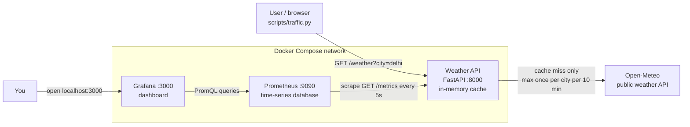

# Grafana Dashboard for API Telemetry

A small weather API (using [Open-Meteo](https://open-meteo.com/)) that exposes metrics, which **Prometheus** collects and **Grafana** shows as live graphs of **request rate, latency and error rate**. Everything runs with **Docker Compose**.

## Team and roles

| Member | GitHub | Role | Owns |
|---|---|---|---|
| Krish Kalsi | [@KrishKalsi](https://github.com/KrishKalsi) | Telemetry and alerting | Repo setup, Prometheus metrics instrumentation, Dockerfile, alert rules, traffic generator, architecture |
| Jaival Katira | [@JaivalKatira](https://github.com/JaivalKatira) | Backend developer | Weather API, Open-Meteo integration, caching, unit tests |
| Maahir Sangani | [@maahir19](https://github.com/maahir19) | DevOps / infrastructure | Docker Compose, Prometheus scraping configuration |
|  |  | Observability / dashboards | Grafana setup and provisioning, telemetry dashboard |

## Architecture

**How a request flows**

1. A user (or `scripts/traffic.py`) calls `GET /weather?city=delhi` on our API.
2. The API checks its cache. On a **miss**, it calls Open-Meteo and saves the result for 10 minutes. On a **hit**, it answers straight away.
3. A middleware in the API times every request and updates two metrics: `http_requests_total` (counter) and `http_request_duration_seconds` (histogram).
4. Every 5 seconds **Prometheus** scrapes `GET /metrics` and stores the numbers with a timestamp.
5. **Grafana** asks Prometheus for the numbers with PromQL and draws request rate, latency (p50/p95/p99) and error rate.

## Tech stack

- **Python 3.12 + FastAPI**: the weather API
- **Open-Meteo**: free weather data, no API key needed
- **prometheus-client**: exposes metrics on `/metrics`
- **Prometheus**: scrapes and stores the metrics
- **Grafana**: dashboards
- **Docker Compose**: runs everything with one command
- **GitHub Actions**: CI that runs tests and checks configs on every push and PR

## Setup and run

_Coming soon._

## Screenshots

_Coming soon._

## Research questions

### 1. What are metrics, logs and traces?

**Metrics** are numbers measured over time, for example "requests per second" or "how long a request took". They are small and cheap to store, so they are good for graphs and alerts. Our API exposes metrics on `/metrics`: a counter `http_requests_total` (how many requests, split by path and status code) and a histogram `http_request_duration_seconds` (how long they took).

**Logs** are text lines that describe single events, for example `GET /weather -> 404 in 0.003s`. They have more detail than metrics, so they help you find out *why* something happened, but they take more space. Our API prints one log line per request (see `docker compose logs api`).

**Traces** follow one request across every service it passes through, and show how long each step took. If our API called a database and two other services, a trace would show which of those steps was slow. We don't use traces because our system has only one service, but tools like OpenTelemetry and Jaeger do this.

**In short:** metrics tell you *that* something is wrong (error rate went up), logs tell you *what* happened (which requests failed), and traces tell you *where* it happened (which service or step was slow).

### 2. How does Prometheus scrape data?

Prometheus visits the API on a timer and reads the numbers. This visit is called a **scrape**.

1. In `prometheus/prometheus.yml` we list **targets**, here `api:8000`, and how often to visit them (`scrape_interval: 5s`).
2. Every 5 seconds Prometheus sends `GET http://api:8000/metrics`.
3. The API answers with plain text, one line per value, for example:
   `http_requests_total{method="GET",path="/weather",status="200"} 152.0`
4. Prometheus saves each value with a **timestamp** in its time-series database. Over time this builds a history we can graph.
5. It also records whether the scrape worked, in a metric called `up` (1 = OK, 0 = failed). You can see this on the Prometheus **Status → Targets** page.

`api` works as a hostname because Docker Compose puts all our containers on the same network and gives each one a DNS name equal to its service name.

**Why pull?** Prometheus decides the pace, so a busy app can't flood it. If a target stops answering, Prometheus notices straight away because `up` becomes 0. Apps also don't need to know where Prometheus is.

### 3. What do latency percentiles and error rate show?

_TODO (Observability): answer in your own words._

## Credits

- Weather data: [Open-Meteo](https://open-meteo.com/) (free, no key)
- Docs: [Prometheus](https://prometheus.io/docs/), [Grafana](https://grafana.com/docs/)
